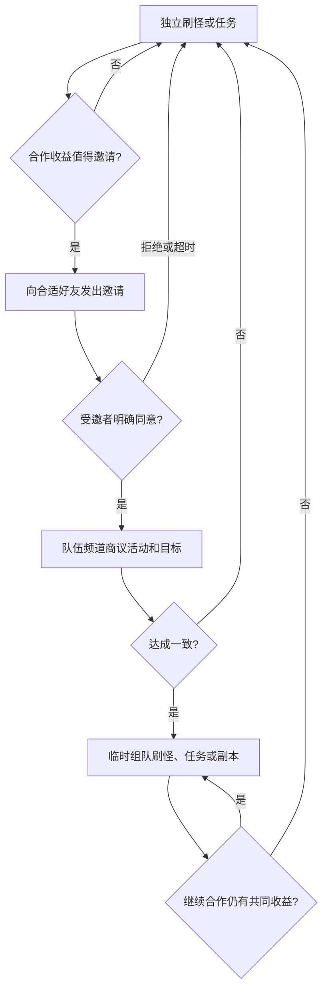
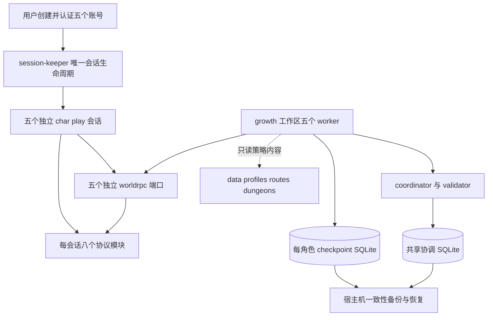
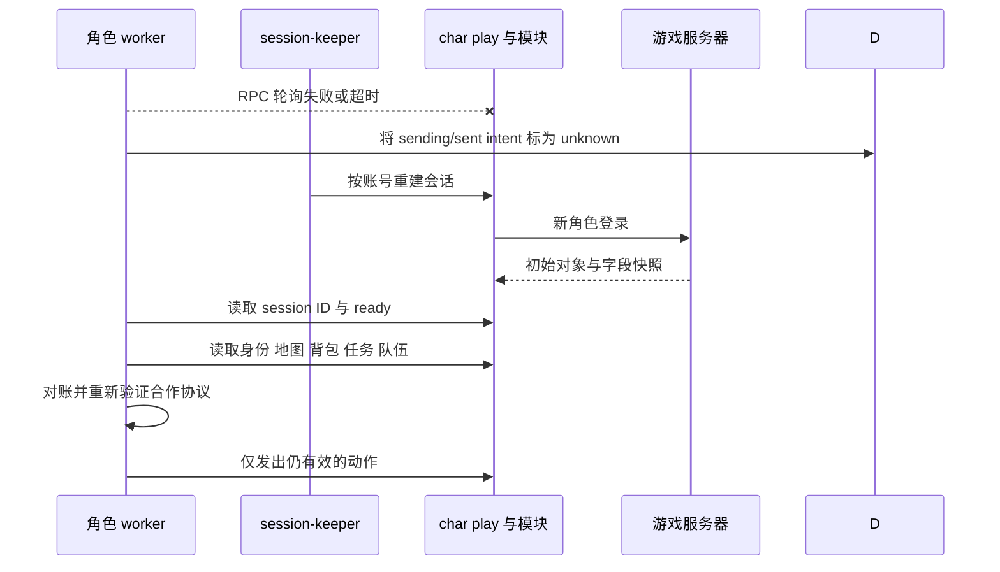
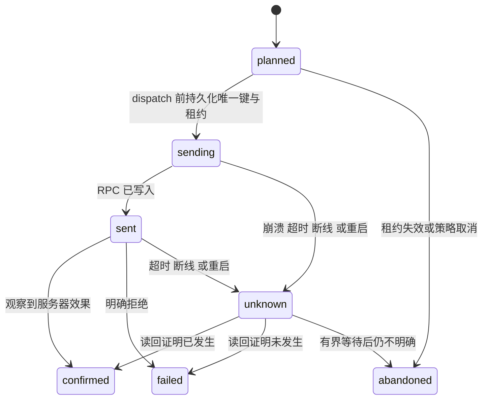
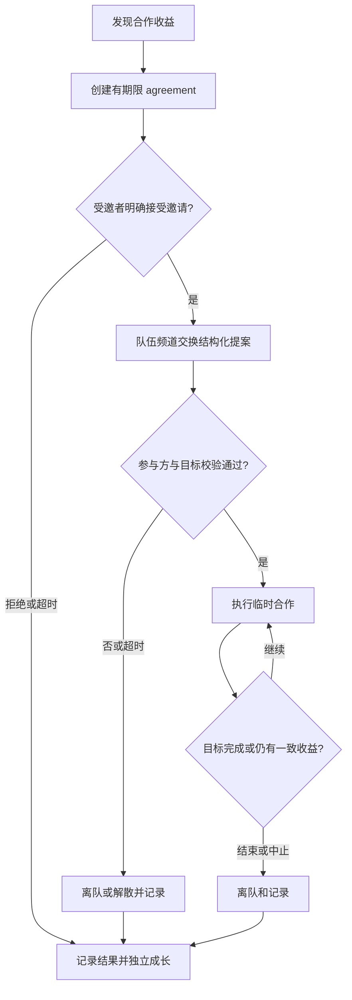
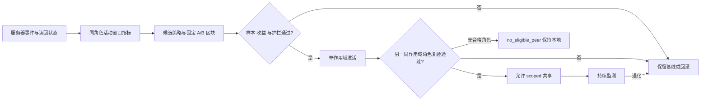

# Five-Character Autonomous Growth MVP - Plan

## Goal Capsule

- **Objective:** 五个由用户创建的新角色能从出生状态无人值守地成长到约 20 级，持续获得等级、装备、技能和专业进展，并通过临时协作完整通关至少一次适合等级的副本。
- **Means:** 五个相互隔离的确定性 worker 驱动角色，模块只提供协议事实与动作，冷启动对账和版本化策略数据支撑长期运行。(KTD1, KTD2, KTD3)
- **Product authority:** 用户已确认的五角色自动成长 MVP 范围及最新协作修订。
- **Planning authority:** 已确认的实现范围、本计划的 KTD 与依赖顺序；具体职业和副本内容以用户最终创建的阵容为准。
- **Open blockers:** `doumoboy1`–`doumoboy5` 五个专用 agent 账号已配置；`doumoboy1` 需要人工交互式重初始化凭据，五个新角色尚未创建。完成这两项后才能开始五角色端到端验收，需求和通用技术设计无未决阻塞。
- **Stop conditions:** 身份或阵容不匹配、凭据失效、服务器协议与 3.3.5a 假设不符、无法证明副本完成时，相关 worker 必须停止或安全降级；不得用 GM 传送、虚假日志或放宽验收标准替代实现。
- **Execution profile:** Deep，按协议、单角色、多角色、五角色四层证据推进；只在用户自己的私人服务器和角色上执行。
- **Completion owner:** 实现 agent 完成代码、测试和运行证据；用户只负责交互式凭据重初始化、角色创建及必要的代码发布审核。

---

## Product Contract

### Summary

五个独立 worker 将从出生开始驱动角色成长，高频动作由确定性策略执行，角色通过好友、邀请和队伍频道形成临时合作。
任务、装备、技能、天赋、专业和资源分配均以服务器状态为依据；只有经过同作用域验证且可回滚的策略数据才会共享。

### Problem Frame

现有多账号能力已经验证多个角色可以同时在线且互不干扰，但在线不等于成长。当前自动循环只覆盖单角色战士刷怪，任务、协作、装备和角色培养尚未形成闭环。
如果五个角色被固定成一个队形，等级、职业和收益差异会让部分角色等待；如果所有临时经验直接共享，未验证策略又会同时放大到所有角色。

### Key Decisions

- **五角色独立成长，而非固定五人小队。** 刷怪和任务默认单独进行，合作按收益临时发生。(session-settled: user-directed — chosen over 固定五人队形: 避免等待并保留单角色成长；Governs R2, R6, R7, R8)
- **邀请后协商，默认需要明确同意。** 组队、共同活动和副本不能由邀请方单方面决定。(session-settled: user-directed — chosen over 自动接受邀请: 保留各角色自主决策；Governs R7, R8)
- **20 级与首次副本通关共同构成 MVP 终点。** 副本时机、是否立即进本和具体副本由角色协商。(session-settled: user-approved — chosen over 仅验证刷怪拾取: 覆盖正常玩家的完整成长结果；Governs R2, R9)
- **职责和实际属性收益决定装备与培养。** 稀有度不能替代职业收益判断。(session-settled: user-approved — chosen over 仅按稀有度换装: 符合职业实战收益；Governs R13, R14, R15, R16)
- **每个角色学习一个采集专业和一个制造专业，并学习辅助技能。** 目标是当前等级可用，不要求 20 级前练满。(session-settled: user-directed — chosen over 单专业或练满: 保留正常玩家的专业成长；Governs R17)
- **共享验证后的策略，不共享所有临时经验。** 通用、职业、地图和单角色状态按作用域隔离。(session-settled: user-approved — chosen over 全量即时共享: 防止错误经验扩散；Governs R18, R19, R20)

### Actors

- A1. **用户：** 注册五个独立账号，创建五个同阵营、同出生区域且包含坦克、治疗和输出职责的新角色，并在创建后授权无人值守运行。
- A2. **五个角色 agent：** 每个 agent 操作一个独立角色，自主决定成长、培养、协作和资源使用。
- A3. **其他自有角色：** 作为好友、受邀者或临时队友，只对明确同意的合作作出承诺。
- A4. **私人服务器及 NPC：** 提供战斗、任务、商人、训练师、专业、交易和副本等游戏规则与状态。

### Requirements

**账号与独立成长**

- R1. 系统必须支持五个独立账号各运行一个新角色，五角色同阵营、同出生区域，并覆盖坦克、治疗和输出职责。
- R2. 每个角色必须从 1 级出生状态独立成长到约 20 级，刷怪和做任务不得以五角色始终组队为前提。
- R3. 用户创建角色并首次登录后，成长过程必须无人值守；单个角色断线、重连或停止不得中断其他角色。
- R4. 每个角色必须能自主选择适合当前等级和职业的目标进行战斗、恢复和刷怪升级，而不是套用固定战士循环。
- R5. 系统必须处理无人值守过程中的死亡、卡怪、背包满和断线，使角色能够恢复成长或安全重试，不能永久停住。

**好友与临时协作**

- R6. 五个角色开局必须互相添加另外四个自有角色为好友，并能识别好友的职业、等级和在线状态。
- R7. 角色可根据职业、等级、在线状态和合作收益发出组队邀请，受邀角色默认必须明确同意后才能加入。
- R8. 组队后角色必须通过队伍频道商议是否一起刷怪、做任务或下副本；拒绝、超时或未达成一致时，各自继续成长，不得无限等待。
- R9. 五角色整体必须在 20 级成长验收前至少完整通关一次适合参与者等级的副本，进本时机、队伍组成和副本选择由角色协商决定。

**任务、拾取与交易**

- R10. 每个角色必须能选择适合自身等级与路线的任务，完成接取、目标进度、任务完成、交付和奖励选择闭环。
- R11. 每个角色必须能拾取战利品，识别任务物品、装备、材料和可出售物品，并在背包空间受限时作出保留或清理决策。
- R12. 每个角色必须能与 NPC 买卖必要物品，并优先购买背包扩容及当前成长所需的基础补给。
- R13. 可交易装备和金币必须能在这五个自有角色之间合理分配，分配依据是接收角色的实际需求与收益，而不是固定轮流或平均分配。

**装备、技能与专业**

- R14. 每个角色必须根据职业职责和实际属性收益比较装备并自动换装，不能只按稀有度决定。
- R15. 每个角色必须按当前等级自主学习和使用职业技能，并根据职责、战斗效果和成长成本调整技能优先级。
- R16. 每个角色必须根据职业职责自主分配天赋，不需要用户指定天赋路线。
- R17. 每个角色必须学习一个采集专业、一个制造专业和适用的辅助技能，并练到与当前等级匹配且能实际使用的程度，不要求 20 级前练满。

**经验验证与共享**

- R18. 系统必须区分通用经验、职业经验、地图经验和单角色临时状态，只允许符合作用域的经验影响其他角色。
- R19. 策略只有经过 XP/小时、死亡率、卡怪率和击杀时间等指标验证后才能共享，出现退化时必须能回滚。
- R20. 公共代码不允许由角色 agent 自行修改并直接发布，经验共享不能绕过这一边界。

### Key Flows

- F1. **初始化与独立成长**
  - **Trigger:** 用户完成五个角色创建并首次登录。
  - **Actors:** A1, A2, A3, A4
  - **Steps:** 五角色互相加好友；各自读取等级、职业和初始状态；分别选择刷怪、任务和培养行动；持续拾取、换装、学习技能与专业。
  - **Outcome:** 五角色无需固定组队即可持续推进 R2、R4、R6、R10 至 R17。

- F2. **邀请与队伍频道协商**
  - **Trigger:** 某角色判断与在线好友合作可能提高收益，或首次副本条件接近成熟。
  - **Actors:** A2, A3
  - **Steps:** 发起方邀请合适角色；受邀方明确接受或拒绝；接受者在队伍频道提出并比较合作意图；达成一致则临时组队行动，否则立即回到各自成长。
  - **Outcome:** 合作遵守 R7、R8，不产生固定队形或无限等待。

- F3. **临时副本协作**
  - **Trigger:** 足够数量的适龄且职责互补的自有角色愿意尝试副本。
  - **Actors:** A2, A3, A4
  - **Steps:** 角色协商副本、时机和职责；参与者共同进本并按坦克、治疗、输出协作；完成最终目标后确认通关并分配可交易收益。
  - **Outcome:** 满足 R9、R13，副本结束后角色可继续独立成长。

- F4. **经验验证与推广**
  - **Trigger:** 某角色形成一个可能复用的新策略。
  - **Actors:** A2, A3
  - **Steps:** 先记录为对应作用域的候选经验；用指标与基线比较；验证有效后才向同作用域角色共享；出现退化则回滚。
  - **Outcome:** 满足 R18 至 R20，单角色试验不会直接污染其他角色或公共代码。

### Acceptance Examples

- AE1. **独立开局**
  - **Covers R1, R2, R6.** **Given** 五个新角色首次登录，**When** 初始化完成，**Then** 每个角色的好友列表都有另外四个自有角色，且它们可以分别刷怪和做任务。

- AE2. **拒绝或没有回应**
  - **Covers R7, R8.** **Given** 角色 A 邀请角色 B 组队，**When** B 拒绝或未在协商期限内回应，**Then** A 和 B 都继续各自成长，不反复等待对方。

- AE3. **协商成功后合作**
  - **Covers R7, R8.** **Given** 受邀角色明确入队，**When** 队伍频道对一起刷怪、任务或副本达成一致，**Then** 只由同意该目标的角色临时合作，未同意者不受约束。

- AE4. **装备看实际收益**
  - **Covers R14.** **Given** 一件更高稀有度装备不适合当前职业职责，**When** 与身上装备比较，**Then** 不自动换上；另一件稀有度较低但实战收益更高的装备可以被换上。

- AE5. **资源分给真正受益者**
  - **Covers R13.** **Given** 某角色获得可交易装备或持有可分配金币，**When** 另一自有角色的实际需求与收益更高，**Then** 可以交易给该角色；无法交易的物品不作跨角色分配承诺。

- AE6. **专业随等级成长**
  - **Covers R17.** **Given** 角色学习了一个采集、一个制造和辅助技能，**When** 角色等级提升，**Then** 专业能力随之提升并用于当前可采集、可制造或可使用的内容，不要求达到满级。

- AE7. **单角色故障不影响其他角色**
  - **Covers R3, R5.** **Given** 五角色都在运行，**When** 其中一个断线或停止，**Then** 该角色能够恢复或安全重试，其他四个继续成长。

- AE8. **经验共享有验证边界**
  - **Covers R18, R19, R20.** **Given** 单角色出现一条未验证的新策略，**When** 尚无指标证明收益，**Then** 不向其他角色推广；已共享策略出现退化时可以回滚，且任何角色都不能借此直接修改并发布公共代码。

- AE9. **首次副本完整通关**
  - **Covers R9.** **Given** 部分或全部自有角色协商组成适合副本的队伍，**When** 完成该副本最终目标，**Then** 记录一次完整通关；只进本、只击杀部分首领或中途解散不算完成。

### Success Criteria

- 五个角色均满足 R2，且能在游戏状态中观察到装备、职业技能、天赋和专业的实际成长。
- 在 20 级成长验收完成前，五角色整体至少完成一次满足 R9 的完整副本通关。
- 整个成长与首次副本过程不需要用户替角色选择任务、装备、技能、天赋、专业或协作决定。

### Scope Boundaries

- 不包含拍卖行、PvP、与真实玩家组队或向真实玩家交易。
- 不要求清完所有任务、通关所有副本，也不要求 20 级前把任何专业练满。
- 不把五个角色固定为永久小队，不要求刷怪和任务共同进行。
- 不由用户预设天赋、技能或装备属性优先级，这些决策由系统自主完成。
- 不把未验证的临时经验直接广播给所有角色，也不允许 agent 自行修改并直接发布公共代码。
- 不建设通用寻路、随机副本匹配或新的 Web 管理界面；路线与副本内容只覆盖最终阵容所需的最小集合。
- 不自动注册账号、执行 `auth login`、提交代码或发布变更。

### Dependencies / Assumptions

- 用户负责角色创建；`doumoboy1` 的凭据重初始化也必须由用户交互完成。具体职业名单以用户最终创建的五个角色为准，但阵容必须满足 R1。
- 私人 AzerothCore WotLK 3.3.5a 服务器提供正常可用的任务、交易、训练、专业和副本规则。
- `doumoboy1`–`doumoboy5` 五个专用 agent 账号已配置；`doumoboy2`–`doumoboy5` 的已保存会话有效但尚无角色，`doumoboy1` 的凭据需要人工重初始化。
- 当前 quest 和 party 只具备部分能力，inventory、vendor/trade、dungeon、trainer/talent 与自动换装尚不能视为已有能力，规划必须覆盖这些缺口及游戏内验证。

### Sources / Research

- `journal/2026-11-02-multi-account.md`：三账号同时在线、独立 RPC、停止隔离和资源实测。
- `journal/2026-11-02-leveling-roadmap.md`：现有刷怪指标、quest 基础、party 缺口和 agent/module 职责边界。
- `scripts/leveling-agent.py`：当前自动循环仍绑定单角色战士，未覆盖任务、协作和完整培养。
- `modules/README.md`：现有模块能力及后续协议能力入口。

---

## Planning Contract

Product Contract unchanged；以下设计只决定实现方式，不改变 R1–R20、F1–F4 或 AE1–AE9 的产品含义。

### Key Technical Decisions

- KTD1. **确定性策略拥有执行权。** 战斗、拾取、背包、任务、培养和状态迁移由可测试规则执行，MVP 不接入 LLM 决策或建议路径；自由文本永不解释为指令。人工全局停止在下一决策边界生效，agent 不得自行恢复。(session-settled: user-approved — chosen over 所有决策持续调用大模型: 降低延迟、成本和不可复现性)
- KTD2. **独立 growth 工作区承载五个 worker。** 在 Colima 中使用 `$HOME/aw-growth` 运行五个独立进程，通过各账号 worldrpc 端口操作角色。每角色使用单 writer 的独立 checkpoint SQLite，保存本地候选指标、已应用策略指针和动作状态；共享协调库由独立 coordinator/validator 单 writer 写入，只保存 agreement、roster/worker registry、协作租约和已推广的 scoped 策略。协调库故障只暂停合作与策略推广，角色沿用最近已应用版本独立成长。宿主机 `data/growth/` 保存可从 VM 重建恢复的一致性备份。
- KTD3. **服务器是游戏事实的唯一权威。** 每次新 session 都等待 `sense` 的初始快照 ready 信号并执行冷启动对账。intent 使用稳定唯一键和 `planned/sending/sent/confirmed/failed/unknown/abandoned`；`planned` 表示尚未 dispatch，`sending` 必须在 RPC 前持久化，重启后 `sending/sent` 一律转为 `unknown`。每模块提供非破坏性 `poll_events(epoch, after_cursor, max)`，返回有序事件、下一游标和分域 dropped 计数；poll 不推进模块侧消费位置，worker 将事件、已提交游标和 intent 放在同一 checkpoint 事务中，提交后的游标就是消费确认。超时或重启后的非幂等动作必须先读回状态，禁止盲目重试或按日志重放。
- KTD4. **沿用八个小模块，不建立高层玩法 RPC。** 扩展现有 `sense/move/combat/party/loot/quest`，新增 `inventory` 和 `character`；模块用短 packet callback、共享有界事件环和 worker 发送，路线、评分、协商、副本完成判定与策略推广仍属于 agent。每模块生产 RPC 保持不超过 10 个（含 `poll_events`），`sense` 的 debug alias 不进入生产 descriptor，并独占 session/技能快照；`character` 与 `quest` 分别执行专业、训练或任务域的对象交互，共用 `lib/wow` codec，不把 `use_object` 塞进感知模块。
- KTD5. **职业与地图内容采用版本化数据。** 角色 profile 提供职责、技能优先级、天赋方向和装备属性权重，路线与副本包提供最小必要内容；装备先检查等级、职业、绑定、武器技能等硬约束，再比较职责收益。版本化内容必须与实际服务器观察共同决策，不能以静态表伪造当前状态。
- KTD6. **通用机制先于阵容内容。** 五个角色创建前完成通用框架和测试替身，最终职业、出生路线、专业组合及首个副本内容在阵容确定后配置。(session-settled: user-approved — chosen over 预先锁死职业和副本: 避免为用户尚未创建的阵容返工)
- KTD7. **首个副本使用手动组队与定制路点。** 不使用随机副本匹配或 GM 传送，提前验证入口、地图切换、必需首领和退出路径。首次进本创建持久 `attempt_id`，首领死亡和队伍证据都绑定该 ID；订阅 `SMSG_INSTANCE_RESET` 并记录地图进出，abort、reset、阵容变化、新 agreement 或非团灭恢复的全队退出重进会轮换它，允许的同 agreement 团灭恢复不会仅因断线或重新进本轮换。完成证据必须属于同一 attempt。(session-settled: user-approved — chosen over 通用寻路或随机副本系统: 将导航风险限制在一个可实测内容包)
- KTD8. **队伍频道是协商信号，持久记录是协商事实。** 结构化消息携带 agreement ID、nonce、期限和参与方；发送者身份取自聊天包，只有确定性校验器能迁移 agreement，未知版本或 intent 整条忽略，自由文本只作展示。聊天去重并限速；活动提案被拒绝或超时后离队或解散，再回到独立成长。
- KTD9. **组队战利品按收益需求分配。** 队伍 leader 明确设置 group loot 与阈值并读回确认；`loot` 解析 roll 窗口并执行由评分决定的 need/greed/pass，roll/locked slot 不进入 auto-loot，超时按 pass 且有界释放。可交易装备和金币再经双方明确接受的交易分配，禁止默认拿走所有可拾取物品。(session-settled: user-approved — chosen over 先拾取者获得全部物品: 避免拾取顺序替代实际收益)
- KTD10. **策略采用同角色交替对照与分阶段推广。** 候选策略先在单角色同等级、地图和活动作用域内比较固定 A/B 区块，达到预注册样本、收益与数值护栏后才允许同作用域复制；退化时下一决策边界恢复上一版本。scope 明确区分 general/class/map/character 及等级、活动等限定条件；无第二个合格角色时记录 `no_eligible_peer` 并保持本地，不伪装成已共享验证。(session-settled: user-approved — chosen over 跨职业直接比较原始 XP/小时: 排除职业、等级和路线差异造成的混淆)

### High-Level Technical Design

**组件与所有权（KTD1、KTD2、KTD4）。** 每个账号继续拥有独立会话、模块容器和 RPC 端口；`session-keeper.py` 是唯一会话动作负责人，growth supervisor 只保活 keeper 和 worker，不直接启停会话。growth worker 不持有账号凭据，也不跨进程共享内存；coordinator/validator 独占共享协调库写权限。

**冷启动与对账（KTD3）。** `agent-wow` 没有会话恢复；worker 通过 RPC 轮询发现断线，由 `session-keeper.py` 重建 `char play`。keeper 对存活客户端持续检查 worldrpc 和必需模块健康，只有达到有界失败阈值才重启对应角色，避免进程仍在但 RPC 已死时永久停住。worker 在新 epoch 中等待登录、首轮 update burst 和必要字段就绪后再行动；ready 是本地行动闸门，不替代后续服务器读回。

**动作状态（KTD3）。** 写成功不等于服务器接受；`confirmed` 必须来自读回状态或服务器事件，`sending` 在 dispatch 前落盘。

**临时协作（KTD8、KTD9）。** 邀请与活动 agreement 分开设期限；队伍形成不代表所有成员同意同一活动，活动协商失败必须解除临时队形。

**策略数据流（KTD10）。** 原始事件先形成同角色指标，再进入候选、试用、激活或回滚；任何阶段都不生成公共代码，无合格复验角色的策略保持本地。

### Runtime and Protocol Constraints

| 约束 | 实现要求 |
|---|---|
| packet callback 5 秒上限，单模块队列 64 packet / 8 MiB，溢出或 handler error 可使会话退出 | callback 只解码、更新受锁保护的状态并入队；解析失败记录后返回成功，worker 队列必须有界并暴露 dropped |
| `SendPacket` 只表示字节写入，且无自动重试 | 所有变更动作都有 pending、deadline、request correlation 和服务器读回 |
| 没有 reconnect、session resume 或 agent 推送事件流 | 使用 session ID 作为 epoch；共享 `lib/events` 统一有界环、非破坏性 poll、游标和分域 dropped 语义，checkpoint 提交后才以下一游标继续拉取；epoch 变化后重置游标并全量对账，任何 dropped 都强制相关域重读 |
| 多开同步会重建每个 VM 工作目录 | 专用 growth 同步与备份脚本只保留 `$HOME/aw-growth` 的 `data/logs`，不同步账号凭据；检测 worker 锁并拒绝覆盖运行中的代码，宿主机备份使用 SQLite backup 而非复制 WAL 文件 |
| agent 不得修改发布公共代码 | growth 使用独立无凭据 UID，代码只读、只有状态目录可写；账号 `config/data` 目录为 0700、凭据与会话文件为 0600 且无组/其他读权限；人工 STOP 控制目录对 growth 只读，同步排除嵌套 `.git` |
| 五人阵容和路线未知 | 内容包在 roster 就绪后生成；未验证的 NPC、字段偏移、首领集合和路点不得标记为已验证 |

### State Ownership and Recovery

| 状态 | 权威来源 | 本地可保存内容 |
|---|---|---|
| 身份、等级、经验、生命、资源、位置、地图 | 登录快照、update fields、移动与战斗读回 | 最近观察值和指标，不可覆盖新 session 事实 |
| 背包、装备、金币、技能、天赋、专业 | update fields、物品查询、训练师与天赋快照 | 评分缓存、购买或换装 intent、已验证元数据 |
| 任务日志与进度 | `PLAYER_QUEST_LOG_*`、任务事件、NPC 菜单与奖励响应 | 任务选择、路线和 intent；重启后从字段重建 |
| 好友、队伍、聊天、交易 | contact/group list、聊天与交易状态包 | agreement、nonce、期限、协商历史和接收游标 |
| 副本进度 | 当前地图、同一 `attempt_id` 的原始首领死亡事件和队伍名单；最终首领成就的持久读回作交叉检查 | 路线、attempt 边界、reset/进出记录、尝试记录、完成证据；不假设存在通用通关包 |
| 策略 | 本地候选指标与已应用版本；共享协调库中的已推广 scoped registry | candidate/canary/active/rolled_back 状态及回滚指针；协调故障时沿用最后已应用版本并暂停推广 |

### Sequencing

U1 先建立隔离、持久化与恢复边界，并用 `doumoboy2`–`doumoboy5` 四个健康账号完成早期故障门禁；`doumoboy1` 凭据修复且八模块拓扑形成后，在 U8 fresh-run 前复测五会话容量。U2 的通用感知和单角色循环是后续玩法的基础；U3 的物品事实供 U4 交易、U5 专业材料、U6 任务物品和奖励评分复用。
U4–U6 可在各自接口稳定后并行推进，但 U7 必须等社交、战斗职责、物品分配和恢复全部通过单角色或多角色门禁。U8 在完整 fresh-run 前接入策略验证和统一验收，不用早期测试角色代替最终五角色验收。

### System-Wide Impact

- 每会话由六个增加到八个模块，五会话将运行约四十个模块容器；三开空闲内存实测不能外推为五开副本容量，必须先做容量门禁。
- `sync-to-vm.sh` 的凭据范围将从整棵 `accounts/` 收紧为当前账号；新增专用 growth 同步与备份入口，`aw-growth` 不同步任何账号凭据，且运行中 worker 会阻止代码同步。
- `session-keeper.py` 保留为唯一自动会话动作负责人，但其 session key 失效后的自动 `auth login` 和重试路径必须移除，改为 degraded 并等待人工；Web、`account.sh play` 和旧 supervisor 只写 session intent，不再绕过 keeper 直接启动。growth supervisor 只保活 keeper/worker，不直接启停会话或切换账号/角色。
- 现有 `party` 默认 auto-accept 必须移除；这不是配置开关，而是 R7 的负向行为验证。
- 现有 `quest` 击杀进度和错误字段需按服务器布局复核；`sense/move` 的朝向文档及缺失的 `combat/README.md` 在对应单元修正。
- 最终验收从五个新角色开始；开发阶段的探测和冒烟角色不占用“出生到 20 级”的验收证据。

### Risks & Dependencies

| 风险 | 影响 | 门禁或缓解 |
|---|---|---|
| 私人服务器字段、opcode 或包布局与参考 AzerothCore 不同 | 动作被静默拒绝或状态错解 | 使用 `pkg/opcode` 常量；逐包 fixture、原始字段探测和双向 live smoke，未确认前不扩展策略 |
| 直线移动无法通过出生区、门口或副本走廊 | 任务和副本永久卡住 | 只采用实测路点；U7 先探测完整入口与首领路线，失败则更换同阵营适龄副本而非伪造完成 |
| 断线时购买、出售、训练、交易或任务交付结果不明 | 重复扣费或错误状态 | KTD3 的 unknown 对账；不能在有限时间内确定则放弃并记录，不直接重试 |
| 队伍聊天被限速、丢包或延迟 | 协商卡住或接受过期协议 | agreement TTL、nonce 去重、有限轮次、频道限速；超时独立成长 |
| 聊天自由文本被当成指令 | 伪造 agreement、交易或进本 | KTD1/KTD8 的负向权限与 validator 独占状态迁移；U4 注入测试 |
| 验收证据只来自 worker 自写事件 | 误判通关或策略收益 | 独立验收记录器保存模块捕获的原始服务器事件并重算；当前状态由服务器读回确认，worker checkpoint 不能单独通过验收 |
| 五会话和新增模块耗尽 Colima 资源 | 多角色一起掉线 | U1 五会话容量测试和运行中资源记录；不足时先增加 VM 资源，不牺牲隔离 |
| 正常副本没有统一 instance ID 或完成包 | 误判通关 | 使用同一 `attempt_id`、地图、必需首领集合和最终队伍名单，reset/非恢复性重进轮换 ID；缺少原始服务器事件或持久成就交叉检查则失败 |
| 策略样本受升级、死亡和跨职业差异污染 | 错误经验扩散 | KTD10 的同角色活动窗口、固定区块、护栏和复验 |

### Sources / Research

- `lib/wow/update.go`、`lib/wow/movement.go`、`modules/quest/src/service/service.go`：现有 update-field、移动和异步 worker 模式。
- `modules/party/src/service/service.go`、`modules/loot/src/service/service.go`：默认 auto-accept 与自动全拾取的行为缺口。
- `scripts/session.sh`、`scripts/sync-to-vm.sh`、`scripts/leveling-supervisor.sh`：账号隔离、同步保留规则和单角色 supervisor 冲突。
- AzerothCore 3.3.5a 固定参考提交 `d80ce1d87720e6b6a0b9adc952f21a658b1c245e` 的 `UpdateFields.h`、`Player.h`、`GroupHandler.cpp`、`ChatHandler.cpp`、`QuestHandler.cpp`、`ItemHandler.cpp`、`TradeHandler.cpp`、`NPCHandler.cpp`：协议与服务器状态机依据，执行时仍需对私人服务器实测。
- [SQLite WAL](https://sqlite.org/wal.html) 与 [SQLite Atomic Commit](https://sqlite.org/atomiccommit.html)：VM-local checkpoint 和一致性备份依据。
- [AWS: Timeouts, retries and backoff with jitter](https://aws.amazon.com/builders-library/timeouts-retries-and-backoff-with-jitter/) 与 [Making retries safe with idempotent APIs](https://aws.amazon.com/builders-library/making-retries-safe-with-idempotent-APIs/)：有界重试与对账依据。
- [Kleppmann: How to do distributed locking](https://martin.kleppmann.com/2016/02/08/how-to-do-distributed-locking.html)：租约和 fencing token 依据。
- [OWASP LLM Prompt Injection](https://genai.owasp.org/llmrisk/llm01-prompt-injection/)：队伍聊天等自由文本不得进入确定性指令通道。

---

## Implementation Units

### U1. 建立五角色持久运行与安全边界

- **Goal:** 用账号作用域的会话管理、单角色锁和冷启动 checkpoint 替代全局单角色循环，同时保证 growth worker 无法读取其他账号凭据或修改公共代码。
- **Requirements:** R1, R3, R5, R20；KTD2, KTD3, KTD4。
- **Files:** `scripts/growth/`, `scripts/growth-supervisor.sh`, `scripts/sync-growth-to-vm.sh`, `scripts/growth-backup.sh`, `scripts/session-keeper.py`, `scripts/leveling-agent.py`, `scripts/leveling-supervisor.sh`, `scripts/account.sh`, `scripts/session.sh`, `scripts/sync-to-vm.sh`, `scripts/lint-modules.sh`, `web/server.py`, `web/README.md`, `lib/events/`, `config/roster.yaml`, `.gitignore`, `data/growth/`.
- **Approach:** 新建标准库 Python growth 包，保留旧刷怪入口直到新 runner 通过等价冒烟；为每角色配置 account、GUID、端口、日志和状态租约。加载 roster 和启动 worker 前分别执行 `agent-policy.py account/char`，校验端口属于该账号，并在每次新 epoch 的首次写动作前用 `sense.get_self` 对照 GUID/name。Web、`account.sh play` 和旧 supervisor 统一写 session intent，`session-keeper.py` 独占自动会话启停、移除自动登录，并对存活客户端执行有界 RPC/模块健康检查；growth supervisor 只保活 keeper/worker。每角色 checkpoint DB 使用 WAL、短事务、稳定 intent 唯一键和 fencing token；共享协调库只由 coordinator/validator UID 写入，worker 通过有界本地请求提交，二者均执行一致性备份并支持 VM 重建恢复。`lib/events` 统一非破坏性 poll、环、游标和 dropped 语义。roster 启动前校验五角色同阵营、同出生区域及坦克/治疗/输出覆盖。人工 `STOP` 文件由 operator 所有、对 growth 只读，supervisor、keeper 和 worker 在启动/重启及决策边界都必须遵守。growth 使用独立 UID 和只读代码，账号目录/文件权限收紧为 0700/0600；`.gitignore` 为版本化 roster 与内容包添加跟踪例外，但继续忽略运行状态。
- **Test Scenarios:**
  - 同角色启动第二个 worker 时，OS 锁和未过期租约使其退出，其他四个 worker 不受影响；混阵营、不同出生区域或缺少职责的 roster 被拒绝。人工账号、未授权角色、跨账号端口和 GUID/name 不匹配均在写动作前拒绝。
  - 在 RPC dispatch 后的 `sending` 及 `sent` 阶段分别杀死 worker，重启后 intent 均变为 `unknown`，没有读回证据前不再次购买、出售、交付或交易。
  - 在事件 poll 后、checkpoint 提交前杀死 worker，重启以旧游标重读且不重复应用事件；dropped 计数或 epoch 变化触发相关域全量重读。
  - 同步一个账号后，其 VM 目录不含其他账号 `auth.json/data`，`aw-growth` 不含账号凭据或嵌套 `.git`；growth 身份写代码/`.git`、读任何账号凭据或直接写共享协调库均失败，账号目录/文件 mode 与 owner 断言为 0700/0600 和预期 UID，只有状态目录可写，运行中同步被锁拒绝。版本化 roster/内容包不被 git 忽略，`data/growth/` 仍被忽略。
  - 停止一个账号会话只终止对应 cwd 的进程；session key 失效只进入 degraded，不自动登录。客户端进程存活但 worldrpc 或必需模块连续失败时，keeper 有界重启该角色；keeper 崩溃由 supervisor 保活，但不产生第二个会话动作负责人。Web/CLI 并发上线只形成一个客户端。
  - 先用 `doumoboy2`–`doumoboy5` 四会话建立容量基线，`doumoboy1` 修复与八模块就绪后再做五会话 30 分钟最终容量门禁。
  - 新 session ID 出现时，worker 在 ready 前不行动，随后重置事件游标并重新验证 agreement 和在途动作。
  - 人工设置 STOP 后，所有 worker 在下一决策边界停止，keeper/supervisor 不再启动或重启，growth 身份无法清除 STOP；只有人工解除后才能恢复。
  - 单角色 checkpoint 损坏或写锁故障不阻塞其他角色；共享协调库故障只暂停合作和策略推广，各角色沿用最后已应用版本。删除并重建 `aw-growth` 后能从宿主机备份恢复，再以服务器事实对账。
  - 多角色故障注入中，一个角色断线、恢复并对账时，其他角色持续获得经验，形成 AE7 的前置证据。
- **Verification:** Python 故障注入、身份门禁、权限与恢复测试通过；早期四会话隔离/容量基线和最终五会话八模块容量门禁分别有 journal 证据；旧入口可删除或仅保留 intent 包装，不能同时驱动同一角色。

### U2. 建立通用感知、移动和单角色成长循环

- **Goal:** 将战士专用刷怪脚本改造成按职业 profile 驱动的独立状态机，覆盖战斗、恢复、卡怪和基础指标。
- **Requirements:** R2, R4, R5, R15；KTD1, KTD4, KTD5, KTD6。
- **Files:** `scripts/growth/`, `data/profiles/`, `data/routes/`, `modules/sense/`, `modules/move/`, `modules/combat/`, `lib/wow/update.go`, `lib/wow/movement.go`, `lib/wow/combat.go`.
- **Approach:** 扩展对象字段、game object、地图切换和各职业 power/cooldown/aura 事实；保持 `move` 不做通用寻路。agent 用安全恢复、城镇、任务、战斗、拾取、协商等显式状态，先支持初始技能循环和实测路点，并持久记录 XP/小时、死亡率、卡怪率及 TTK p50/p90。
- **Test Scenarios:**
  - 战士怒气、治疗法力和盗贼能量分别读取正确字段，低资源时不进入无效技能循环。
  - 朝向 `0=+X` 与 `atan2(dy, dx)` 的单元及 live smoke 一致，不再出现文档驱动的 bad-facing 循环。
  - 目标不可达或长时间无击杀时，worker 拉黑目标、侧移并换路，而不是无限攻击。
  - 死亡、灵魂医者、尸体回收和断线冷启动后均能回到可行动状态。
  - 地图切换清空旧位置和旧目标，不在新地图攻击 stale GUID。
- **Verification:** 相关 Go race 测试和 Python 状态机测试通过；每种最终职业完成一次战斗/恢复 live smoke，形成 AE1 的独立刷怪证据；文档与实测一致。

### U3. 完成背包、装备评分和 NPC 买卖闭环

- **Goal:** 让角色看见物品真实属性与空间，按职责换装，并能购买背包、补给和出售低价值物品而不重复扣费。
- **Requirements:** R5, R11, R12, R14；KTD3, KTD4, KTD5。
- **Files:** `modules/inventory/`, `modules/loot/`, `lib/wow/item.go`, `lib/wow/inventory.go`, `lib/wow/vendor.go`, `scripts/growth/`, `data/profiles/`.
- **Approach:** 新增一个物品所有权与转移模块，提供背包/装备/物品查询、装备、vendor list/buy/sell/repair 和后续 trade 所需的共用状态；vendor/trade 采用有界 action 流程而不是玩法策略 RPC。loot 暴露 slot/type 并支持选择性拾取，物品模板和属性通过服务器查询缓存。
- **Test Scenarios:**
  - 更高稀有度但职责收益更低的装备不换；更低稀有度且收益更高的合法装备换上，旧装备回到背包。
  - 背包满时保护任务物品、升级候选和必需材料，先出售可售低价值物，再按明确策略清理，最后恢复成长。
  - 购买背包或补给时校验 1-based vendor slot、金币和库存，背包扩容优先于一般补给；购买、出售或修理响应丢失后先读背包、金币、耐久和 buyback，不重复出售同一物品或重复扣费，无法判定时有界放弃。
  - 装备因等级、职业、绑定或武器技能被拒绝时记录原因，不持续重试。
  - 队伍战利品窗口不会被 solo auto-loot 逻辑抢先全部拿走。
- **Verification:** item/inventory/vendor codec、模块 worker、评分及买卖/修理故障注入测试通过；每角色 live 完成一次买、卖、换装与背包满恢复，形成 AE4 证据。

### U4. 完成好友、明确组队、频道协商和双方交易

- **Goal:** 五角色能互加好友并识别在线状态，只在明确同意后形成临时队伍，通过受限协议协商活动并安全分配可交易资源。
- **Requirements:** R6, R7, R8, R13；KTD1, KTD3, KTD8, KTD9。
- **Files:** `modules/party/`, `modules/inventory/`, `modules/loot/`, `lib/wow/group.go`, `lib/wow/contact.go`, `lib/wow/chat.go`, `lib/wow/trade.go`, `lib/wow/loot.go`, `scripts/growth/`.
- **Approach:** `party` 统一承载 contacts、pending invites、group roster 和 party chat，移除默认 auto-accept；邀请和活动 agreement 均有 ID、nonce、TTL 与状态，活动失败后离队或解散。leader 设置并读回 group loot/threshold；`loot` 新增 roll 窗口与 need/greed/pass 原子动作，解析 start/won/all-passed，roll 或 locked slot 不走 auto-loot，超时按 pass 并有界释放。交易只允许 roster 内双方且重新确认物品、金币和接受状态；group roll 使用 U3 评分，自由文本只作展示。
- **Test Scenarios:**
  - 每个角色的 contact list 都有另外四人，远程在线、等级和职业来自 contact/who 读回；单个好友添加失败时有界重试并记录缺失，未齐前不启动协作，超过期限使初始化门禁失败。
  - 非 roster 或未明确接受的邀请不会发送 accept；拒绝、重复、过期和 late accept 均不形成有效合作。
  - 接受邀请但未接受活动提案的成员不被拉入活动；提案拒绝或超时后队伍离队/解散，双方在有界时间内继续 solo。
  - 重复、乱序、伪造 sender、注入文本和聊天突发不会改变 agreement 或触发 RPC，超限消息被限速。
  - 双方接受前修改物品、取消或断线会中止并读回未转移；双方接受后断线则标记 `unknown`，重连后以双方背包、金币和交易状态判定，不能仅凭本地 cancel 宣布失败或直接重试。
  - roll 窗口中各角色按评分发送 need/greed/pass；loot method 未读回确认时不开始按需分配，重复或 late roll 无效，pass/超时不拾取，只有赢家背包读回该物品，locked/roll slot 不被 solo auto-loot 拿走，窗口最终释放。
- **Verification:** 协议、状态机、对抗输入和双角色集成测试通过；live 验证 AE2、AE3、AE5、group-loot roll 与交易歧义对账，并验证 AE1 的好友/在线/职业/等级子句；AE1 的刷怪与任务子句分别由 U2/U6 提供，最终由 U8 重算。

### U5. 完成技能、天赋和专业成长

- **Goal:** 角色能根据等级、职责、成本和现有状态学习并使用技能与天赋，且实际提升一个采集、一个制造和适用辅助专业。
- **Requirements:** R15, R16, R17；KTD1, KTD3, KTD5, KTD6。
- **Files:** `modules/character/`, `modules/combat/`, `modules/sense/`, `lib/wow/trainer.go`, `lib/wow/talent.go`, `lib/wow/spell.go`, `lib/wow/gameobject.go`, `scripts/growth/`, `data/profiles/`, `data/professions/`.
- **Approach:** 新模块提供训练师列表/购买、天赋学习和专业/采集动作；`sense.get_skills` 是唯一技能与专业快照，`character` 不另建平行真相。制造复用施法事实，采集复用 game object 与 loot。profile 自主生成技能和天赋优先级，训练前检查 known/usable、等级和预算，专业只要求达到当前等级可用并产生真实 skill-up。
- **Test Scenarios:**
  - 可学技能按职责与预算学习，已学或不可用技能不重复购买；模糊结果先读 spellbook 和金币。
  - 天赋学习后 `SMSG_TALENTS_INFO` 与所选 rank 一致，非当前职责路线不会仅因固定模板被覆盖。
  - 每个角色学到规定专业组合，并至少完成一次有效采集或制造及辅助技能使用，技能字段实际增长；未达专业 tier 的等级/技能前置时不购买，达到后才训练，不要求 20 级前练满。
  - 材料不足、技能上限、训练师距离或金币不足时进入补给/替代活动，不形成训练循环。
  - 需要 game object 的采集能识别、交互并拾取；失败对象进入有界 blacklist。
- **Verification:** trainer/talent/spell/game-object 测试和 live 双向验证通过；五角色最终状态满足 AE6。

### U6. 完成可恢复的任务闭环

- **Goal:** 角色能按路线和奖励收益选择任务，完成接取、目标、交付和奖励选择，并在重启后从服务器重建任务日志。
- **Requirements:** R5, R10, R11, R14；KTD3, KTD4, KTD5。
- **Files:** `modules/quest/`, `modules/sense/`, `lib/wow/quest.go`, `lib/wow/quest_details.go`, `lib/wow/update.go`, `scripts/growth/`, `data/quests/`, `data/routes/`.
- **Approach:** 从 `PLAYER_QUEST_LOG_*` 重建 25 个任务槽及计数，补充 quest details、物品目标、奖励物品和必要的 game-object 目标；保留单 flight turn-in worker。agent 只选择当前路线支持的 kill/collect/interact 任务，奖励使用 U3 评分，escort 与无 POI 支持的内容不进入最小内容包。
- **Test Scenarios:**
  - 接取后任务出现在服务器任务槽；重启模块和会话后无需重复 accept 即可恢复 ID、状态和计数。
  - 24-byte kill update、物品计数和 complete 状态正确解析；quest-invalid reason 按 `uint32` 解码，截断或错误包不会杀死会话。
  - turn-in 超时后先读任务槽、奖励物品和金币；仍在日志才允许重试，已完成则不重复选择奖励。
  - 更高职责收益奖励被选中，背包空间不足时先清理再交付。
  - 前置不足、任务日志满或目标不受支持时放弃该选择并继续其他成长活动。
- **Verification:** codec、完整 worker、重启对账测试通过；每角色 live 完成至少一条 accept→objective→turn-in→reward 链，形成 AE1 的独立任务证据。

### U7. 完成可证明的临时副本协作

- **Goal:** 适龄且职责互补的自有角色能协商组成临时队伍，手动进本、按职责作战、处理团灭与分配，并以机器可验证证据记录一次完整通关。
- **Requirements:** R7, R8, R9, R13；KTD1, KTD3, KTD6, KTD7, KTD8, KTD9。
- **Files:** `scripts/growth/`, `data/dungeons/`, `data/routes/`, `modules/sense/`, `modules/move/`, `modules/combat/`, `modules/party/`, `modules/loot/`, `lib/wow/dungeon.go`.
- **Approach:** 阵容确定后选择一个同阵营、路线最短的适龄副本，内容包定义入口/出口路点、推荐等级、最小人数与职责、必需首领和最终首领。为避免独立成长拉开等级后永远无法进本，较快角色达到副本适配上限后暂停有经验的战斗和任务，转做制造、补给、装备与路线准备；其余角色进入等级带后恢复协商，超过预注册期限则明确记录 R9 失败而非无限等待。按 KTD7 持久化 `attempt_id` 及 reset/地图边界，所有首领与 roster 证据绑定该 ID，最终 roster 快照取最终首领死亡时。独立验收记录器通过只读 RPC 自行 poll 模块捕获的原始服务器事件，写入 verifier 所有且 worker 不可写的宿主机 append-only 记录；原始事件是首领死亡、XP 和战斗指标的主证据，当前状态读回是地图、roster 和背包的主证据，并增加最终首领成就的持久读回交叉检查。先单独探测入口、全程路线、出口和成就读回，再接入坦克先手、治疗资源、DPS assist、拉怪上限、团灭恢复和中止条件；不新增 `run_dungeon` 高层模块。
- **Test Scenarios:**
  - 参与者接受同一 agreement 后才进入 forming，等级、阵营、职责或人数不符的提案被拒绝且各方继续 solo。一名角色升级较快时会在副本等级带上限转入无经验准备活动，其余角色到达后仍能组成队伍；超过期限则报告失败而不等待。
  - 入口和地图切换经实测通过；超时未变图、成员离线、团灭达到上限或路线失效时有界中止并离队。副本中杀死 participant 后按新 epoch 对账，旧 fencing token 被拒绝，有效团灭恢复仍归属原 `attempt_id`。
  - 首领死亡、reset 和地图事件均来自独立记录器保存的原始服务器事件；击杀一个必需首领后 reset、重进并击杀其余首领时 `attempt_id` 必须轮换，拼接证据判定失败。非团灭恢复的全队退出重进同样轮换，有效团灭恢复不错误轮换。
  - 所有参与者处于目标地图，且同一 `attempt_id` 记录内容包要求的全部首领死亡和最终首领死亡时的队伍名单才判定完成；最终首领成就必须能通过后续快照读回。
  - 只进本、缺一个必需首领、不同 `attempt_id` 拼接首领、最终前解散、成就交叉检查缺失、原始事件出现 dropped 缺口或仅凭 worker checkpoint/日志文本均判定失败。
  - 团灭后能在允许次数内重新集合继续；战利品按 KTD9 分配。完成或中止后沿实测出口回到副本外，或以有界恢复离开；验收器要求地图、移动或战斗读回证明角色已恢复独立成长。
- **Verification:** 先完成空跑入口、路线、出口、首领信号与成就读回探测，再完成至少一次真实全队 clear；AE9 证据由 acceptance verifier 从独立 append-only 原始事件和持久状态按 `attempt_id` 重算通过。

### U8. 完成经验验证、回滚与五角色总验收

- **Goal:** 用同角色指标证明策略收益和作用域，再对五个新角色执行从出生到约 20 级及首次副本的完整无人值守验收。
- **Requirements:** R1–R20，重点 R18, R19, R20；KTD1, KTD2, KTD10。
- **Files:** `scripts/growth/`, `scripts/growth/acceptance.py`, `data/growth/`, `journal/2026-11-03-autonomous-growth.md`, `modules/README.md`, 各模块 `README.md`.
- **Approach:** 本地候选指标、每角色已应用指针与回滚状态保存在角色 checkpoint；只有验证后推广的 scoped 策略及复验证据进入共享协调库，协调故障时沿用最后已应用版本并暂停推广。采用预注册活动窗口与同角色交替 A/B 区块，跨 session epoch、死亡恢复、升级、策略切换 washout 或服务器停机的 block 作废；每项实验在开始前登记具体样本量、5% 收益门槛和死亡率/卡怪率/TTK 数值护栏，缺项不得开始，排除原因留证。候选先 shadow/canary，达标后仅激活当前 scope，另一个合格角色复验后才共享；无合格角色或复验失败则保持本地，fresh-run 不强制制造一条共享策略，正向共享路径由两个合格角色的确定性集成测试覆盖。独立验收记录器保存模块原始服务器事件并重算事件型指标，当前状态由服务器读回确认，输出 AE1–AE9 结果。
- **Test Scenarios:**
  - 未达有效样本量或 XP/小时提升不足 5% 的候选不推广；断线、死亡、升级或 washout 污染的 block 不计入样本，护栏超过预注册阈值时保留基线并记录原因。
  - general/class/map/character 四类 scope 各有隔离断言；无第二合格角色时记录 `no_eligible_peer` 且不共享，有合格角色但 canary 失败也不共享，character 临时状态永不改变其他角色版本。两个合格角色的集成测试必须展示一次第二角色复验和 scoped 共享，但该正向结果不是 fresh-run 的强制前置。
  - 运行前后公共代码 checksum 一致，growth 身份写代码、读取凭据或访问外网均失败，仅保留本机 worldrpc 与状态目录，无 git/gh 发布路径；人工全局 STOP 生效且 agent 不能自行恢复，聊天注入或非法结构化 intent 无 RPC/packet 旁路。
  - 五角色 fresh-run 中一个角色反复断线时其他四个继续获得经验，恢复角色不重复购买、交付或接受过期协议；VM 重建恢复与副本中新 epoch 对账由 U1/U7 证据联动验收。
  - 验收前先拒绝不满足 R1 的 roster；最终五角色均约 20 级且技能、天赋、装备和专业有服务器证据，首次完整副本在验收前完成，AE1–AE9 全部通过。存在合格复验角色且 canary 通过时才要求出现共享策略，否则接受完整的 `no_eligible_peer`/本地策略证据。
- **Verification:** 策略与验收器单元测试、完整 soak、资源记录和 AE1–AE9 机器报告全部通过；任何所需原始服务器事件缺口或当前状态读回缺失都保持失败而不人工改写结果。

---

## Verification Contract

| 层级 | 命令或检查 | 通过标准 |
|---|---|---|
| 模块结构与共享库 | `./scripts/lint-modules.sh`，并对 `lib/wow` 与 `lib/events` 执行 `go test -race ./...` | 所有直接子模块有效、descriptor/manifest/README 完整、无嵌套 `.git`，gofmt、协议及事件环 overflow/cursor/dropped 测试通过 |
| Go 协议与服务 | 对每个变更模块执行 `go test -race ./...` | codec 截断输入、worker 时序、单 flight、事件环溢出和状态读回测试无 race、无失败 |
| Python 策略与恢复 | `python3 -m unittest discover -s scripts/growth/tests -v` | 状态机、评分、协商、对账、租约、指标、策略推广和验收器测试全部通过 |
| 恢复与故障隔离 | 破坏并重建 `aw-growth`，在任务/副本中 kill worker，重放旧 fencing token | 从宿主机备份恢复并对账，无重复购买/交付/进本，其他角色继续，AE7 通过 |
| 人类专属与聊天边界 | session key 失效、聊天注入、人工全局 STOP 及 growth 权限/账号/角色/端口/GUID 负向检查 | 不自动 `auth login`，未授权身份不能写，STOP 不能被 agent 清除，无 RPC/packet/发布旁路 |
| 镜像构建 | 对每个 `aw-<account>` 执行模块构建，并运行 `agent-wow module list` | 五会话都能发现相同版本的八个模块及声明 RPC，无缺失 service 或依赖 |
| 单角色 live gate | 每职业执行战斗/死亡/任务/买卖/训练/专业冒烟 | RPC 发送后均有服务器状态证据，模块 README 只记录实际验证过的能力 |
| 多角色 live gate | 两至五角色执行好友、拒绝/接受、聊天、group roll、交易、故障隔离 | AE1 的社交子句、AE2–AE5、AE7 通过，非明确同意、重复动作和交易歧义有负向证据 |
| 副本 gate | 对最终内容包先跑入口/出口路线和成就读回探测，再执行完整尝试、reset 与副本中故障恢复 | AE9 由独立原始事件、同一 `attempt_id` 的必需首领、最终 roster 和持久成就重算通过，部分、reset 或拼接 clear 失败 |
| 策略与代码边界 | 运行策略故障注入及运行前后 checksum/权限检查 | AE8 通过，候选不扩散、退化可回滚、公共代码无运行时变化 |
| 验收证据独立性 | verifier 以独立游标读取模块原始服务器事件，并重读地图、roster、成就、背包和角色成长状态 | 原始事件是事件型事实主证据，服务器读回是当前状态主证据；任一所需证据缺失即失败，worker checkpoint 只作佐证 |
| 最终 fresh-run | `python3 scripts/growth/acceptance.py --run <run-id>` | 五个新角色完成 R2 与 R9，AE1–AE9 全部通过，资源与断线记录完整 |

每个新协议能力按“fixture → module fake session → 单角色双向 live → 多角色集成”顺序验证；后一层通过不能倒推前一层可以省略。
所有 live 验证使用普通角色；GM 命令只可用于独立诊断，不得为验收角色传送、改等级、生成物品或修改任务/首领状态。

---

## Definition of Done

- 五个用户创建的新角色从 1 级无人值守成长到约 20 级，期间无需用户替角色做任务、装备、技能、天赋、专业或协作决定。
- 五角色整体在验收前至少完成一次符合 AE9 的副本，且验收器能重算证据；只进本、部分首领或拼接多次尝试不算完成。
- R1–R20 均有对应实现和测试或 live 证据，AE1–AE9 全部通过；单个角色故障不影响其他四个。
- 高频策略可复现，聊天自由文本不能绕过确定性校验；未验证经验不共享，退化策略能回滚。
- 非幂等动作经历断线/重启故障注入，无未对账的盲目重试；服务器读回是完成依据。
- 账号凭据不进入 growth 工作区，公共代码在自主运行中不被修改或发布。
- 每个模块 README 记录 RPC、前置条件、限制和真实 Verified 边界；journal 保存容量、断线、路线、副本和最终验收结果。
- 所有实施单元通过其 Verification，最终 `Verification Contract` 全绿；没有失败测试被隐藏或改写成通过。
- 删除废弃实验、重复协议解析、旧 supervisor 冲突路径和无调用者的临时代码；不得把失败尝试留在最终 diff 中。

| Unit | 完成信号 |
|---|---|
| U1 | 早期四会话隔离、低权限 growth、单角色锁、冷启动与备份恢复通过；最终五会话八模块容量门禁通过 |
| U2 | 最终职业均可独立战斗与恢复，指标持久化，地图/资源/朝向事实经 live 验证 |
| U3 | 买卖、背包满和职责换装闭环通过，模糊购买不重复扣费 |
| U4 | 好友、显式同意、限时协商、双方交易、group roll 和按需分配通过正负向集成测试 |
| U5 | 五角色技能、天赋、专业状态实际成长，采集/制造产生服务器 skill-up |
| U6 | 每角色完整任务链接通，重启重建日志，交付与奖励不重复 |
| U7 | 最终副本路线可执行，团灭/退出有界恢复，完整通关证据可重算 |
| U8 | scoped 策略验证与回滚通过，五个 fresh 角色的 AE1–AE9 总验收通过 |
